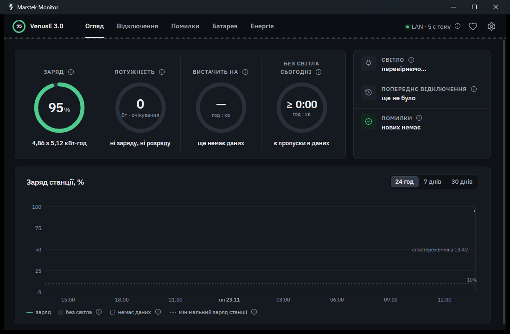

# Marstek Monitor

## Українською

> Це репозиторій коду. Готовий інсталятор та інструкція для користувачів — у [econ11/marstek-monitor](https://github.com/econ11/marstek-monitor) ([релізи](https://github.com/econ11/marstek-monitor/releases/latest)).

Marstek Monitor — неофіційний додаток для Windows у системному треї. Він стежить за домашньою батареєю Marstek по локальній мережі (перевірено на Venus E 3.0, прошивка v151) і веде облік відключень світла: коли світло зникло, коли повернулось, скільки тривало, статистика. Також показує заряд, потужність, енергію, цикли батареї з оцінкою здоров'я та журнал подій.

Додаток не пов'язаний з Marstek. Іконка додатка не містить логотипа Marstek.

### Можливості

- Вкладки: **Огляд**, **Відключення**, **Помилки**, **Батарея**, **Енергія**.
- Іконка в треї змінюється залежно від того, є світло чи ні; подробиці — у підказці та меню іконки.
- Сповіщення Windows: зникло світло, світло з'явилось, низький заряд (з порогом), станція заряджена, немає зв'язку зі станцією. Тиха година (за замовчуванням 23:00 – 07:00) і разовий режим «Не турбувати» з меню трею; «Низький заряд» приходить і тоді.
- Інтерфейс українською та англійською (за замовчуванням — мова Windows).
- Перший запуск: пошук станції в локальній мережі або ручне введення IP.
- Експорт у CSV (відключення, події, заряд за вибраний період) і налаштування терміну зберігання історії.
- Запуск разом з Windows (опційно).

### Приватність

- Лише локальна мережа: UDP, порт 30000, JSON-RPC (Open API станції). Без хмари, без телеметрії.
- Запити в інтернет — лише перевірка оновлень (раз на добу й за кнопкою, анонімний GET до `api.github.com/repos/econ11/marstek-monitor/releases/latest`) і завантаження оновлення з GitHub після вашого кліку; без персональних даних. Автоматичну перевірку можна вимкнути в налаштуваннях.
- Усі дані лишаються на вашому комп'ютері в `%LOCALAPPDATA%\MarstekMonitor`.
- Додаток надсилає станції лише `ES.GetStatus` і `Marstek.GetDevice`. `Bat.GetStatus` додаток не викликає свідомо: на тестовій станції (Venus E 3.0, v151) після цього виклику станція тричі замовкала понад 60 с і один раз перезапустилась, а перезапуск може знеструмити будинок. Рішення власника проєкту 2026-11-23, його перевіряє тест у `core/monitor`. Тож температур батареї та прапорців BMS у додатку немає.

### Вимоги

- Windows 10 або 11.
- Станція в тій самій локальній мережі з увімкненим локальним API (Open API). Його вмикають на самій станції: через застосунок Marstek Venus Monitor (по Bluetooth) або через підтримку Marstek (у додатку є шаблон листа з серійним номером). Офіційна специфікація: [MarstekDeviceOpenApi.pdf](https://resource.marstekenergy.com/ems/resource/agreement/MarstekDeviceOpenApi.pdf). Спільнота повідомляє, що на прошивках 138–148 API нестабільний.

### Встановлення

Готовий інсталятор — на [сторінці релізів](https://github.com/econ11/marstek-monitor/releases/latest), інструкція для користувачів — у [README релізного репозиторію](https://github.com/econ11/marstek-monitor#readme).

Збірка з вихідного коду:

1. Go (версія з `go.mod`, мінімум 1.26.0), Node.js, [Wails v3](https://v3.wails.io): `go install github.com/wailsapp/wails/v3/cmd/wails3@v3.1.0`.
2. `npm --prefix frontend install`
3. `wails3 build` — результат: `bin\marstek-monitor.exe`.

Демо без станції: `bin\marstek-monitor.exe -simulate-quiet` запускає несправжню станцію на 127.0.0.1 з тимчасовою базою (справжню станцію й ваші дані не чіпає).

Windows може показати SmartScreen для непідписаного exe.

### Статус

v1.0.0 — перший публічний реліз для Windows. Порт на macOS заплановано. Помилки й побажання — в [Issues](https://github.com/econ11/marstek-monitor-code/issues). Як випускати реліз — [docs/releasing.md](docs/releasing.md).

### Підтримати автора

<https://donatello.to/econ11>

### Ліцензія

MIT, див. [LICENSE](LICENSE).

---

## English

> This is the code repository. The ready-made installer and the user guide are in [econ11/marstek-monitor](https://github.com/econ11/marstek-monitor) ([releases](https://github.com/econ11/marstek-monitor/releases/latest)).

Marstek Monitor is an unofficial Windows tray app that watches a Marstek home battery over the local network (tested on Venus E 3.0, firmware v151) and keeps a record of grid outages: when the power went off, when it came back, how long it lasted, and statistics. It also shows charge, power, energy, battery cycles with a health estimate, and an event log.

It is not affiliated with Marstek. The app icon contains no Marstek logo.

### Features

- Tabs: **Overview**, **Outages**, **Errors**, **Battery**, **Energy** (Ukrainian UI labels: Огляд, Відключення, Помилки, Батарея, Енергія).
- The tray icon switches between grid on and grid off; details are in its tooltip and menu.
- Windows notifications: grid lost, grid back, low charge (with a threshold), station fully charged, no connection to the station. Quiet hours (default 23:00 – 07:00) and a one-off «Do not disturb» from the tray menu; «Low charge» still comes through in both cases.
- Ukrainian and English UI (defaults to the Windows language).
- First run: station discovery on the LAN or a manually entered IP.
- CSV export (outages, events, charge for a chosen period) and a history retention setting.
- Optional start with Windows.

### Privacy

- Local network only: UDP port 30000, JSON-RPC (the station's Open API). No cloud, no telemetry.
- The update check (once a day and on the button, an anonymous GET to `api.github.com/repos/econ11/marstek-monitor/releases/latest`) and the one-click update download from GitHub are the only internet requests, with no personal data. The automatic check can be turned off in Settings.
- All data stays on your computer in `%LOCALAPPDATA%\MarstekMonitor`.
- The app sends the station only `ES.GetStatus` and `Marstek.GetDevice`. It deliberately never calls `Bat.GetStatus`: on the tested station (Venus E 3.0, v151) the station went silent for over 60 s after that call three times and restarted once, and a restart can cut power to the house. This is the project owner's decision of 2026-11-23, guarded by a test in `core/monitor`. As a result the app has no battery temperatures or BMS flags.

### Requirements

- Windows 10 or 11.
- A station on the same LAN with the local API (Open API) enabled. It is enabled on the station itself: via the Marstek Venus Monitor app (over Bluetooth) or through Marstek support (the app includes an email template with your serial number). Official spec: [MarstekDeviceOpenApi.pdf](https://resource.marstekenergy.com/ems/resource/agreement/MarstekDeviceOpenApi.pdf). The community reports the API is unstable on firmware 138–148.

### Install

The ready-made installer is on the [releases page](https://github.com/econ11/marstek-monitor/releases/latest); the user guide is the [release repo README](https://github.com/econ11/marstek-monitor#readme).

Build from source:

1. Go (version from `go.mod`, at least 1.26.0), Node.js, [Wails v3](https://v3.wails.io): `go install github.com/wailsapp/wails/v3/cmd/wails3@v3.1.0`.
2. `npm --prefix frontend install`
3. `wails3 build` — output: `bin\marstek-monitor.exe`.

Demo without a station: `bin\marstek-monitor.exe -simulate-quiet` runs a simulated station on 127.0.0.1 with a temporary database (it does not touch a real station or your data).

Windows may show SmartScreen for an unsigned exe.

### Status

v1.0.0 is the first public Windows release. A macOS port is planned. Bugs and ideas go to [Issues](https://github.com/econ11/marstek-monitor-code/issues). Releasing: [docs/releasing.md](docs/releasing.md).

### Support the author

<https://donatello.to/econ11>

### License

MIT, see [LICENSE](LICENSE).
