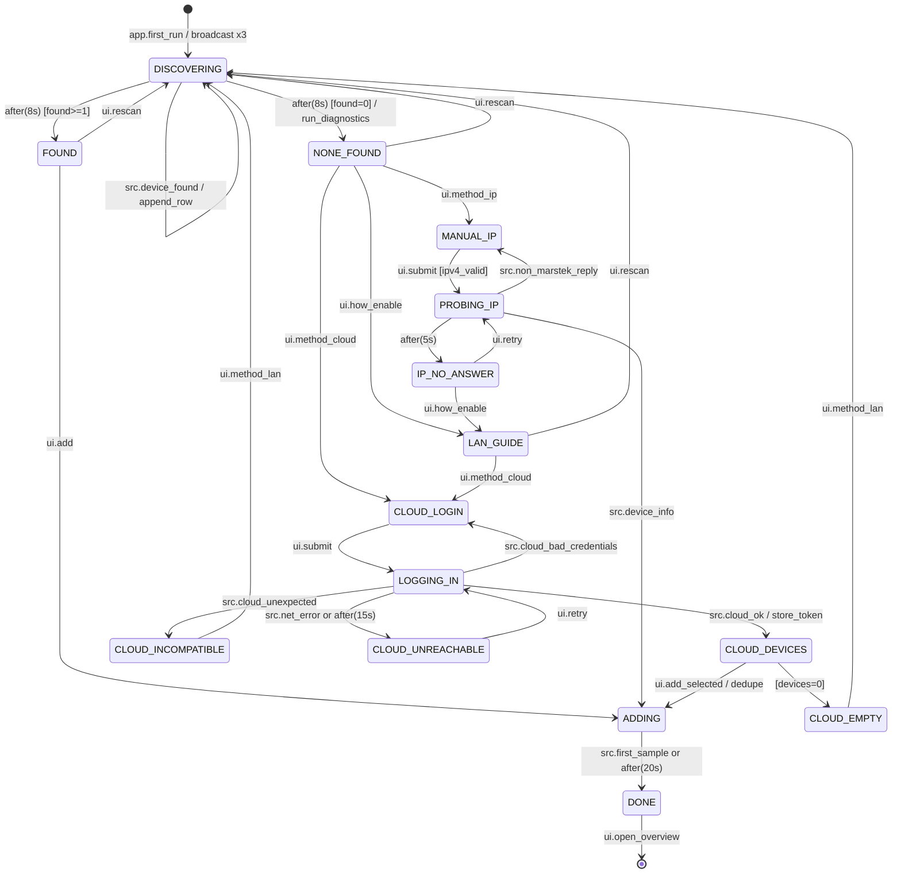
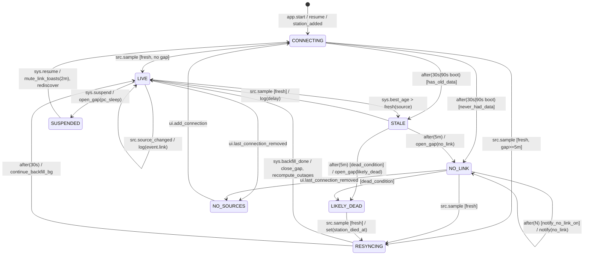
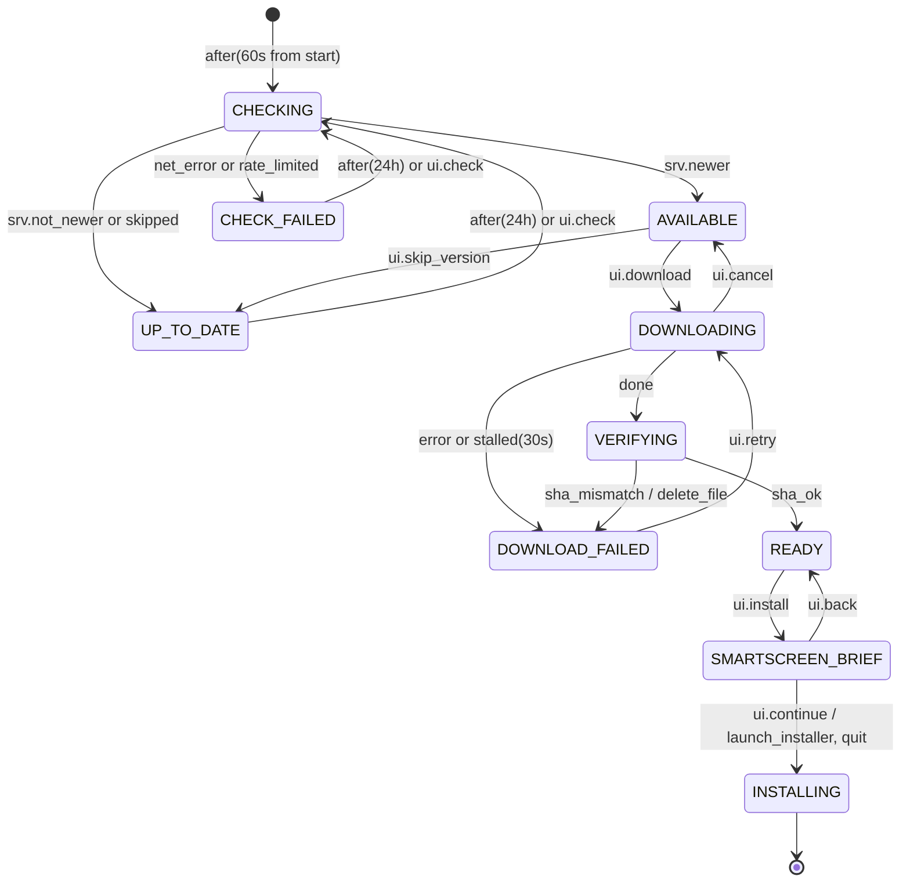

# Marstek Monitor — потоки, стани, крайні випадки

Дата: 2026-11-21 · Статус: чернетка на погодження · Доповнює `2026-11-21-marstek-monitor-design.md` (далі — «спек»).

Що це: макети показують лише щасливий шлях. Тут — скінченні автомати (FSM), порожні та часткові стани, трей, оновлення, з таймінгами і причинами для кожного числа. Рішення **[вирішено]** зі спеку не змінюються; усе нове тут — **[пропозиція]**, власник може виправити.

**Обсяг v1 [вирішено власником]:** перша версія — тільки локальна мережа (див. спек §2 «Перша версія» і §7.9). Усе про хмару (вхід, CLOUD_*, дозавантаження історії, «LAN втрачено, хмара OK»), BLE і автооновлення (§6: завантаження, SHA-256, SmartScreen, бекап БД) — для наступних версій; у v1 цих гілок немає, а перевірка оновлень — лише повідомлення з посиланням. Перший запуск у v1: якщо станцію не знайдено — головна дія «Як увімкнути локальний API», далі «Вказати IP вручну». Брандмауер — не в інсталяторі, а одноразовою дією з UAC за діагнозом (спек §7.9).

**Тексти.** Рядки позначені *наміром* у вигляді `copy:ключ` (напр. `copy:link.stale.banner`). Остаточні формулювання uk/en — у `...-copy.md` (UX-writer). Тут вказано лише, *що* рядок має сказати і які дані він може підставити.

**Нотація.** Стани `SCREAMING_SNAKE_CASE`, названі за станом, а не за екраном. Переходи: `подія [умова] / ефект`. Простори подій: `ui.*` (дія користувача), `src.*` (факт від джерела даних: LAN / хмара / BLE), `sys.*` (локальне: таймер, ОС, сон ПК). Таймери: `after(30s)`. Тип стану: **transient** (виходить сам, завжди має таймаут), **stable** (чекає зовнішньої події), **terminal**.

---

## 0. Головні рішення (коротко)

| # | Рішення | Чому |
|---|---|---|
| D1 | **Дві незалежні осі стану станції:** *Зв'язок* (наскільки свіжі дані) і *Живлення* (мережа є/немає/невідомо + режим батареї). Екран = комбінація двох осей, а не один «статус». | Анти-ціль «застарілі дані як поточні» вимагає, щоб свіжість контролювала, *чи взагалі* показувати значення живлення як поточні. Змішати осі = отримати «світло є» на даних годинної давнини. |
| D2 | **Вік даних = час вимірювання, а не час отримання.** Для хмари — мітка часу звіту пристрою в хмарі. | Хмара може без кінця віддавати той самий останній звіт мертвої станції. Якщо міряти за часом запиту, мертва станція виглядатиме «живою через хмару». |
| D3 | **Розрізняти «показник не підтримується» і «значення зараз невідоме».** Не підтримується жодним джерелом → елемент *ховається* (з одним рядком пояснення у «Про станцію»). Тимчасово невідоме → *заглушка* «—» з причиною. | Узгоджено з §9 спеку («ховається, а не показує вигадані значення»), але без зникнення кілець при кожній втраті зв'язку — стрибки макета гірші за чесне «—». |
| D4 | **«До початку спостережень» ≠ «пропуск».** Час до першого запису станції — порожня вісь з міткою «спостереження з ДД.ММ», без пунктирної рамки. Пропуск (рамка + «немає даних») — лише всередині спостережуваного періоду, і завжди з причиною (додаток не працював / ПК спав / немає зв'язку / станція, ймовірно, розрядилась / оновлення). | Інакше новий користувач бачить 29 днів «пропусків» і думає, що додаток зламаний. |
| D5 | **Сповіщення лише з живих даних.** Події, відновлені заднім числом (з хмари після старту, з дозавантаження), ніколи не дають toast; замість цього — одна картка «Поки додаток не працював» на Огляді. | Toast «Зникло світло» о 08:30 про відключення о 02:10 — шум і плутанина. |
| D6 | **На першому запуску пошук у мережі стартує сам**, без кнопки; якщо нічого не знайдено, головна дія — **увійти в хмару** (найкоротший шлях до перших даних), а інструкція з увімкнення локального API — другорядна. | Time-to-first-data. Більшість нових користувачів не мають увімкненого локального API; хмара працює без налаштування станції. |
| D7 | **Тиха година не глушить, а приглушує:** сповіщення йдуть у Центр сповіщень Windows без спливання і звуку; «Низький заряд» спливає завжди. | Вранці видно, що було вночі; нічого не губиться. |

---

## 1. Перший запуск: від встановлення до перших живих даних

### 1.1 Метадані
- **Тригер:** перший старт після інсталяції (у БД немає жодної станції). Також — коли користувач видалив останню станцію (той самий автомат, але без привітання).
- **Актор:** власник станції; від «технар, що знає IP» до «бачив станцію лише в додатку на телефоні».
- **Передумови:** Windows 10/11, WebView2. **Не вимагається:** акаунт, Bluetooth, адмін-права.
- **JTBD:** «Коли я щойно встановив монітор, я хочу побачити свою станцію за хвилину, щоб переконатись, що це працює, і забути про налаштування.»
- **Мета:** перший запис `LIVE` для першої станції. Цільовий час від відкриття вікна: ≤ 15 с через LAN, ≤ 60 с через хмару.
- **Метрики:** телеметрії немає (спек §8). Додаток пише локальний діагностичний журнал кроків онбордингу (стан, тривалість, клас помилки) — його можна прикласти до issue на GitHub. Це єдиний «вимір».

### 1.2 Точки входу

| Вхід | Стартовий стан | Що несе |
|---|---|---|
| Інсталятор → «Запустити зараз» | `DISCOVERING` | — |
| Ярлик / меню Пуск, станцій 0 | `DISCOVERING` | — |
| Автозапуск з Windows, станцій 0 | нічого не показувати; трей-іконка «немає станцій» | Не відкривати вікно самостійно при старті системи |
| «＋ Додати станцію» (вже є станції) | `CHOOSING_METHOD` (сітка з 3 плиток) з пошуком, запущеним одразу | id станцій, що вже додані (для дедуплікації) |
| Видалено останню станцію | `DISCOVERING` без привітання | — |

### 1.3 Екран (одна сторінка, не майстер)

Перший запуск — це вікно «Додати станцію» з макета 02 (§6), розгорнуте на все вікно, з одним рядком привітання зверху. Не окремий welcome-екран: він не наближає до даних.

```
┌ Marstek Monitor ───────────────────────────────────────────┐
│  copy:onb.hello  (1 рядок: що робить додаток)               │
│                                                            │
│  [📶 Пошук у мережі ●шукаю…] [☁ Акаунт Marstek] [⌨ IP]      │
│                                                            │
│  ── Знайдено в мережі ─────────────────────────────────    │
│  ░░░░░░░░░░░░░░░░░ (скелетон рядка, 0–8 с)                  │
│                                                            │
│  copy:onb.lan_hint  «Не бачите своєї? …»                    │
└────────────────────────────────────────────────────────────┘
```

Мова: за мовою Windows (спек §3); перемикач мови — маленький, у куті цього ж екрана (перший запуск — єдине місце, де людина ще не знає, де налаштування).

### 1.4 Стани

| Стан | Тип | Вхід | Виходи | Таймаут | Повторний вхід |
|---|---|---|---|---|---|
| `DISCOVERING` | transient | відкриття екрана; `ui.rescan` | `src.device_found` → self (рядок додається одразу, не чекаючи кінця); `after(8s) [found≥1]` → `FOUND`; `after(8s) [found=0]` → `NONE_FOUND` | 8 с: 3 broadcast-и `Marstek.GetDevice` з інтервалом 2 с на всі активні IPv4-інтерфейси + 2 с на запізнілі відповіді. Venus E відповідає за < 1 с; 3 спроби покривають втрату UDP-пакета | при поверненні на екран — запустити заново, не відновлювати |
| `FOUND` | stable | ≥1 станція відповіла | `ui.add(device)` → `ADDING`; `ui.rescan` → `DISCOVERING`; `ui.method_cloud` → `CLOUD_LOGIN`; `ui.method_ip` → `MANUAL_IP` | none — користувач вирішує | restore (повторний пошук у фоні) |
| `NONE_FOUND` | stable | 0 відповідей | `ui.method_cloud` → `CLOUD_LOGIN` (**головна кнопка**); `ui.how_enable` → `LAN_GUIDE`; `ui.method_ip` → `MANUAL_IP`; `ui.rescan` → `DISCOVERING` | none | restore |
| `LAN_GUIDE` | stable | `ui.how_enable` | `ui.rescan` → `DISCOVERING`; `ui.back` → `NONE_FOUND`; `ui.method_cloud` → `CLOUD_LOGIN` | none | restore |
| `MANUAL_IP` | stable | `ui.method_ip` | `ui.submit [ipv4_valid]` → `PROBING_IP`; `[!ipv4_valid]` → self з помилкою поля | none | restore (введене значення зберігається в пам'яті екрана) |
| `PROBING_IP` | transient | submit | `src.device_info` → `ADDING`; `src.non_marstek_reply` → `MANUAL_IP` (помилка: «відповів не Marstek»); `after(5s)` → `IP_NO_ANSWER` | 5 с: 2 unicast-запити по 2.5 с. Довше — людина вважає, що все зависло | redirect → `MANUAL_IP` |
| `IP_NO_ANSWER` | stable | немає відповіді | `ui.retry` → `PROBING_IP`; `ui.how_enable` → `LAN_GUIDE`; `ui.method_cloud` → `CLOUD_LOGIN`; `ui.edit_ip` → `MANUAL_IP` | none | restore |
| `CLOUD_LOGIN` | stable | вибір хмари | `ui.submit [email_valid ∧ pwd≠∅]` → `LOGGING_IN` | none | restore (email зберігається, пароль — ні) |
| `LOGGING_IN` | transient | submit | `src.cloud_ok` → `CLOUD_DEVICES`; `src.cloud_bad_credentials` → `CLOUD_LOGIN` + помилка біля пароля; `src.cloud_unexpected` → `CLOUD_INCOMPATIBLE`; `src.net_error` → `CLOUD_UNREACHABLE`; `src.rate_limited` → `CLOUD_LOGIN` + блок кнопки з відліком | 15 с: хмара за кордоном, через мобільний інтернет під час відключення буває повільно; довше — `CLOUD_UNREACHABLE` | redirect → `CLOUD_LOGIN` |
| `CLOUD_UNREACHABLE` | stable | мережева помилка / таймаут | `ui.retry` → `LOGGING_IN`; `ui.method_lan` → `DISCOVERING` | none | restore |
| `CLOUD_INCOMPATIBLE` | stable | відповідь, яку додаток не розуміє (капча, 2FA, змінений протокол, HTML замість JSON) | `ui.retry` → `CLOUD_LOGIN`; `ui.method_lan` → `DISCOVERING`; `ui.copy_diag` / `ui.open_issue` (відкриває GitHub issue з шаблоном, **без** пароля/токена) | none | restore |
| `CLOUD_DEVICES` | stable | вхід вдався | `ui.add_selected [≥1]` → `ADDING`; `[0 devices]` → `CLOUD_EMPTY` | none | restore |
| `CLOUD_EMPTY` | stable | акаунт без пристроїв | `ui.method_lan` → `DISCOVERING`; `ui.logout` → `CLOUD_LOGIN` | none | restore |
| `ADDING` | transient | додати | `src.first_sample` → `DONE`; `after(20s)` → `DONE` з позначкою «чекаємо перших даних» (станція збережена, автомат зв'язку §2 продовжує сам) | 20 с: станцію вже збережено, далі не тримати людину на екрані | redirect → Огляд |
| `DONE` | stable | збережено | `ui.open_overview` → Огляд; `ui.add_another` → `CHOOSING_METHOD`; поле назви редагується інлайн | none | redirect → Огляд |

Пароль ніколи не зберігається в стані екрана після `LOGGING_IN`: токен — у Credential Manager (спек §8).

### 1.5 Ключові кроки — когнітивний аналіз

**`NONE_FOUND` — найчастіший стан першого запуску і найнебезпечніший.**
- *Ментальна модель:* «станція ж у Wi-Fi, телефон її бачить — значить, і ПК має бачити». Людина не знає про «локальний API» і що його треба вмикати.
- *Емоція:* сумнів «я щось зробив не так / додаток не працює». Найвищий ризик відмови.
- *Рішення:* System 2. Тому на екрані **рівно три дії** (Хік): головна — «Увійти в акаунт Marstek» (працює без налаштувань станції), друга — «Як увімкнути локальний доступ», третя — «Вказати IP». Плюс «Шукати ще раз» як текстове посилання.
- `copy:onb.none_found` має назвати найімовірнішу причину першою — «на станції вимкнений локальний доступ (так за замовчуванням)» — а не «станцій не знайдено». Причина без вини користувача (клас «невідповідність налаштувань», не «помилка»).
- *Евристики:* H9 (вихід з помилки з наступною дією), H10 (довідка в контексті, не FAQ).
- *Тертя:* 🟢 продуктивне лише якщо одразу є обхідний шлях (хмара). Без нього — 🔴.

**`LAN_GUIDE` — інструкція увімкнення локального API.** Вбудована в екран, не посилання на зовнішню сторінку як єдиний варіант. Зміст (формулювання — writer, факти — розробник перевіряє):
1. Шлях A: інструмент Marstek Venus Monitor (веб, Web Bluetooth) з пристрою, що має Bluetooth і браузер з Web Bluetooth: Chrome/Edge на Android або ПК з Bluetooth. **На iPhone Safari Web Bluetooth не підтримує** — для iPhone потрібен окремий браузер з підтримкою (напр. Bluefy) — *розробнику перевірити, що це працює з Venus E 3.0*.
2. Шлях B: написати в підтримку Marstek з серійним номером (шаблон листа — кнопка «Скопіювати текст»).
3. Після увімкнення — кнопка «Шукати ще раз» прямо тут.
4. Блок «Поки що» — «Можна почати з хмари і додати локальне підключення пізніше» → `CLOUD_LOGIN`.

Причини, які додаток може визначити сам і показати замість загальної поради (перевіряються під час `DISCOVERING`):

| Перевірка | Як | Що показати |
|---|---|---|
| Профіль мережі Windows = «Загальнодоступна» | `INetworkListManager` / `Get-NetConnectionProfile` | `copy:onb.net_public` — broadcast-відповіді блокуються; як змінити на «Приватна» |
| Брандмауер блокує вхідний UDP | інсталятор **додає правило** для приватних мереж (див. §8 «Розробнику»); якщо правила немає — підказка | `copy:onb.firewall` |
| Активний VPN / кілька інтерфейсів | перелік інтерфейсів | broadcast іде на всі; якщо ПК поза підмережею станції — підказка «IP вручну» |
| Немає жодного IPv4 з приватним діапазоном | інтерфейси | `copy:onb.no_lan` — «ПК не в локальній мережі» |

**`CLOUD_LOGIN`.**
- *Ментальна модель:* «той самий акаунт, що в телефоні» (макет 02). Підписи полів — так само, як у додатку Marstek.
- Дрібним під формою (`copy:onb.cloud_privacy`): пароль зберігається у Windows Credential Manager і йде тільки на сервери Marstek; хмара неофіційна і може змінитись.
- **Відкрите питання для розробника (блокує реліз хмари):** чи вхід з нашого клієнта розлогінює офіційний додаток на телефоні (одноразова сесія на акаунт)? Якщо так — це має бути сказано **до** кнопки «Увійти», а не виявлено користувачем.

**`CLOUD_INCOMPATIBLE` — 2FA / капча / змінений протокол.** Додаток не намагається проходити капчу. Чесно: «Хмара Marstek попросила додаткову перевірку або змінила спосіб входу — додаток поки не вміє це обробити» (клас «нам не під силу», не вина користувача), плюс шлях через LAN і кнопка «Повідомити розробника» (GitHub issue з версією додатка і кодом відповіді, без облікових даних).

**`DONE` — назва і другий шлях.**
- Назва за замовчуванням: ім'я пристрою з хмари, якщо є; інакше модель («Venus E 3.0»). Поле редагується інлайн на цьому екрані — **не окремий крок** (distill: людина з однією станцією назву не змінює ніколи).
- Якщо додано лише LAN — одна необов'язкова картка «Додати хмару як запасний канал: коли локальний API замовкає, дані йтимуть через хмару» (`copy:onb.offer_cloud`). Якщо лише хмара — «Увімкніть локальний доступ: дані щосекунди, без інтернету» (`copy:onb.offer_lan`). Не повторюється, закривається назавжди.
- Рядок про автозапуск і трей (вже ввімкнено, бо [вирішено]) з перемикачем на місці — людина має знати, що вікно закриється у трей.
- Підказка Windows 11: нові іконки ховаються в «^». Одна картинка «перетягніть іконку на панель задач» — необов'язкова, закривається.

### 1.6 Діаграма



### 1.7 Крайні випадки онбордингу

| # | Умова | Ймовірн. | Обробка |
|---|---|---|---|
| O1 | Знайдено станцію, яка вже додана | Сер. | Рядок з позначкою «вже додана», кнопка «Відкрити» замість «Додати» |
| O2 | Знайдено кілька станцій (сусіди в спільному Wi-Fi, дача + дім в одній мережі) | Низ. | Список з серійником (останні 4 символи) і моделлю; жодної не обирати автоматично |
| O3 | Станція в хмарі збігається зі знайденою по LAN | Сер. | Об'єднати автоматично за MAC/серійником (§4.3); показати один рядок «LAN + хмара» |
| O4 | Модель не Venus E 3.0 | Сер. | Додати з позначкою «може працювати, не тестувалося» (спек §7.6); не блокувати |
| O5 | Невідома модель, профілю немає | Низ. | Додати; кільця, що потребують номінальних значень (макс. потужність, ємність), — `—` з поясненням; запропонувати ввести ємність вручну у «Станції» |
| O6 | Користувач закрив вікно під час `DISCOVERING`/`LOGGING_IN` | Сер. | Запит скасовується; при наступному відкритті — `DISCOVERING` знову. Якщо `LOGGING_IN` встиг повернути токен — він зберігається, наступний вхід відкриє `CLOUD_DEVICES` |
| O7 | Невірний пароль 5 разів поспіль | Низ. | Після 3-ї спроби — посилання «Скинути пароль у додатку Marstek»; після блокування сервером — `rate_limited` з реальним часом очікування |
| O8 | Під час онбордингу зникло світло і роутер перезавантажився | Сер. (Україна) | `DISCOVERING` просто дає `NONE_FOUND`; діагностика «немає мережі» — по інтерфейсах. Без вини користувача |
| O9 | Станцію додано, але `ADDING` не отримав даних за 20 с | Сер. | `DONE` з `copy:onb.waiting_first_data`; Огляд показує `CONNECTING` (§2) — ніяких нулів у кільцях |

---

## 2. Автомат зв'язку станції (вісь «Зв'язок»)

Один екземпляр на станцію. Працює в Go-ядрі (`core/merge` + `core/detect`), фронтенд лише відображає. Кожен стан виводиться з: `(для кожного джерела: останній вимір + його вік + стан запитів), стан живлення з останнього свіжого виміру, сон/старт ПК)` — тож він переживає перезапуск без збереження «поточного стану».

### 2.1 Пороги

| Величина | Значення | Причина |
|---|---|---|
| LAN-опитування | 5 с (налаштування) | спек §5.8 |
| LAN «свіже» | вік ≤ 3 × інтервал (15 с) | спек §7.2; 2 втрачені UDP-пакети — ще не проблема |
| LAN «втрачено» | 3 поспіль запити без відповіді | ≈15 с; одна втрата UDP — норма |
| LAN бекоф | 5 → 10 → 20 → 40 → 60 с, далі **60 с назавжди** + broadcast-перевиявлення кожні 60 с | API на Venus E замовкає на години, але повертається; здаватись не можна. 60 с — не навантажує станцію і дає повернення за ≤ 1 хв |
| Хмара-опитування | 60 с; при `LIVE(source=cloud)` — 30 с | хмара оновлюється пристроєм раз на кілька хвилин; частіше — лише навантаження і ризик бану |
| Хмара «свіже» | вік **виміру** ≤ 10 хв | спек §7.2 |
| `STALE` → `NO_LINK` | 5 хв у `STALE` | достатньо, щоб пережити перезавантаження роутера (типово 1–3 хв), і досить коротко, щоб людина не дивилась на «останні дані» без пояснення |
| `LIKELY_DEAD` | одразу з `NO_LINK`, якщо виконано умову (§2.3) | |
| Старт / вихід зі сну | `CONNECTING` до 30 с; після старту Windows — 90 с | після завантаження ОС Wi-Fi і DHCP піднімаються 20–60 с; не кричати «немає зв'язку» в цей час |
| `RESYNCING` | ≤ 30 с, далі фоново | дозавантаження з хмари може бути повільним; не тримати UI |
| Дебаунс мережі (вісь живлення) | 30 с | спек §7.3 |

### 2.2 Стани

| Стан | Тип | Що правда | Вхід | Виходи | Таймаут |
|---|---|---|---|---|---|
| `CONNECTING` | transient | Немає свіжого виміру з моменту старту/пробудження/додавання | старт додатка, `sys.resume`, додавання станції | `src.sample [fresh]` → `RESYNCING` (якщо був пропуск) або `LIVE`; `after(30s / 90s at boot) [!fresh]` → `STALE` (якщо є старі дані) або `NO_LINK` (якщо даних ніколи не було) | 30 с / 90 с |
| `LIVE` | stable | Найкраще джерело свіже. Пропси: `source ∈ {lan, ble, cloud}`, `lan_lost: bool`, `cloud_lost: bool` | свіжий вимір | `sys.best_age > fresh(source)` → `STALE`; зміна `source` → self (подія в журналі); `sys.suspend` → `SUSPENDED` | none — стан підтримується потоком даних |
| `STALE` | stable | Жодне джерело не свіже, але останні дані молодші за 5 хв понад поріг | вік перевищив поріг | `src.sample [fresh]` → `LIVE` (пропуск < 5 хв не реєструється як пропуск, лише як «затримка» в журналі); `after(5m)` → `NO_LINK` або `LIKELY_DEAD` | 5 хв |
| `NO_LINK` | stable | Немає свіжих даних > 5 хв. Пропс `diagnosis` (див. нижче) | з `STALE` або `CONNECTING` | `src.sample [fresh]` → `RESYNCING`; `[умова dead]` → `LIKELY_DEAD`; `after(N min) [notify_enabled]` / `emit(notify.no_link)` (лишається в стані) | none (сповіщення — ефект, не перехід) |
| `LIKELY_DEAD` | stable | `NO_LINK` + умова §2.3. Висновок, не факт — завжди «ймовірно» | з `NO_LINK`/`STALE` | `src.sample [fresh]` → `RESYNCING` (записати `station_died_at` = останній вимір, кінець пропуску = перший новий) | none: чекаємо, поки повернеться мережа |
| `RESYNCING` | transient | Дані повернулись після пропуску ≥ 5 хв або після старту з пропуском | перший свіжий вимір після пропуску | `sys.backfill_done` → `LIVE`; `after(30s)` → `LIVE` + фонове дозавантаження з індикатором | 30 с |
| `SUSPENDED` | stable | ПК заснув/гібернація | `sys.suspend` (`WM_POWERBROADCAST`) | `sys.resume` → `CONNECTING` | none — ПК спить, додаток не працює |
| `NO_SOURCES` | stable | У станції не лишилось жодного підключення (вийшли з хмари, а LAN не було) | `ui.cloud_logout`, видалення підключення | `ui.add_connection` → `CONNECTING` | none |

`diagnosis` для `NO_LINK` (визначає текст і пораду; розраховується з факту, а не вгадується):

| Діагноз | Умова | Що сказати (намір `copy:link.dx.*`) |
|---|---|---|
| `pc_offline` | немає жодного мережевого інтерфейсу з адресою / хмара недосяжна **і** LAN недосяжний | «Цей ПК не в мережі» — проблема на нашому боці, не станції |
| `device_silent_in_cloud` | хмара відповідає, але останній звіт станції старий | «Станція не звітує в хмару з ЧЧ:ХХ» — сильна ознака, що станція або роутер вимкнені |
| `lan_silent_cloud_absent` | LAN мовчить, хмара не налаштована | «Локальний API станції не відповідає з ЧЧ:ХХ (відома проблема прошивки — зазвичай повертається сам)» + пропозиція додати хмару як запасний канал |
| `cloud_unreachable` | лише хмара, сервер недосяжний / 5xx | «Хмара Marstek недоступна» |
| `cloud_auth_expired` | 401 від хмари, оновлення токена не вдалося | «Потрібно знову увійти в хмару» + кнопка — це **єдиний** діагноз, що вимагає дії користувача |
| `cloud_incompatible` | відповіді, які не розбираються | «Хмара змінила формат — потрібне оновлення додатка» + перевірка оновлень |

### 2.3 Умова `LIKELY_DEAD`

`NO_LINK` **і** останній відомий стан мережі = «немає» **і** одне з:
- останній SOC ≤ мінімальний SOC + 5 п.п. (зазвичай ≤ 15%), або
- прогноз «До розряду» з останнього виміру вже минув, або
- останній вимір показав режим «вихід вимкнено захистом» (якщо API це віддає; див. рядок «станція вимкнула вихід (10%)» у макеті Помилок).

Час смерті показується як «≈ о ЧЧ:ХХ» = `min(час останнього виміру + прогноз, …)`, з позначкою «оцінка». Пропуск на графіку отримує причину «станція, ймовірно, розрядилась».

**Важливо для типового користувача:** ПК і роутер живляться від станції. Коли станція розряджається, додаток зазвичай *помирає разом з нею* (якщо це не ноутбук). Тож `LIKELY_DEAD` найчастіше встановлюється **заднім числом** при наступному старті: останній запис — «немає мережі, SOC 11%», потім пропуск, перший новий запис — «мережа є, SOC 9%». Ядро при старті проганяє ту саму умову на останньому записі й пише `station_died_at` (спек §7.3). Живий `LIKELY_DEAD` — для ноутбуків і ПК на окремому ДБЖ.

### 2.4 Діаграма



### 2.5 Вісь «Живлення» (з останнього свіжого виміру)

| Стан | Умова | Примітка |
|---|---|---|
| `GRID_ON` | мережевий вхід є (поле — спек §9 п.1) ≥ 30 с | |
| `GRID_OFF` | немає ≥ 30 с | відкриває запис `outages` |
| `GRID_UNKNOWN` | поле мережі не підтримується жодним джерелом **або** вісь «Зв'язок» не `LIVE` | **Не продовжувати** останній відомий стан: «Мережа: невідомо з ЧЧ:ХХ» |

Режим батареї (пропс): `charging` (P > +20 Вт), `discharging` (P < −20 Вт), `idle` (|P| ≤ 20 Вт), `cutoff` (SOC на мінімумі, розряд заборонено). 20 Вт — шум вимірювання/власне споживання; без мертвої зони кільце мерехтітиме між «очікування» і «розряд 3 Вт».

### 2.6 Що показують Огляд, трей і сповіщення

Огляд = вісь Зв'язок × вісь Живлення. Рядок «Джерело даних» у правій колонці — завжди з віком.

| Зв'язок | Огляд: верхній ряд кілець | Графік SOC | Права колонка | Банер над кільцями | Трей-іконка | Тултіп трея |
|---|---|---|---|---|---|---|
| `CONNECTING` (перші дані ніколи не було) | Скелетони кілець, без чисел | Скелетон | Скелетони | немає | Нейтральна сіра без рівня | `copy:tray.connecting` |
| `CONNECTING` (є старі дані) | Як `STALE` | Останні дані | Як `STALE` | `copy:link.connecting` (тонкий, без тривоги) | Як `STALE` | |
| `LIVE / lan` | Стан за макетом (розряд / заряд / очікування) | Живий | «LAN · 3 с тому» | немає | За пріоритетом нижче | макет §5.7 |
| `LIVE / cloud` | Те саме; числа оновлюються раз на хвилини | Те саме | «хмара · 2 хв тому» + якщо `lan_lost`: другим рядком `copy:link.lan_lost_since` | немає (не тривожити: дані є) | За пріоритетом | + «через хмару» |
| `STALE` | Значення останнього виміру **приглушені** (opacity ~50%, без кольору стану), прогнози (До розряду / До повного / Вистачить на) → «—», анімацій немає | Лінія обривається на останньому вимірі, далі — нічого (не продовжується) | «Мережа: невідомо з ЧЧ:ХХ» | `copy:link.stale.banner` — «Дані на ЧЧ:ХХ, чекаємо зв'язку» | Сіра, **рівень з останнього виміру зберігається**, без значка стану | «дані на ЧЧ:ХХ» |
| `NO_LINK` | Кільця приглушені, у центрі кільця Заряд — останнє значення з міткою «о ЧЧ:ХХ» | Пропуск відкрито (пунктирна рамка до «зараз») | Діагноз + порада (§2.2) | `copy:link.dx.*` з дією, якщо вона є | Сіра пунктирна + «×» (макет) | діагноз |
| `LIKELY_DEAD` | Кільце Заряд приглушене з останнім відомим «11% о 00:40» (не вигаданий «0%») і рядок «ймовірно, розрядилась ≈ о 00:55» | Пропуск з причиною | Відключення «триває ≥ 3 г 10 хв» | `copy:link.likely_dead` | Сіра пунктирна + «×» | «ймовірно, розрядилась»; toast 🪫 лише якщо виявлено наживо (див. §11 Q4) |
| `RESYNCING` | Нові живі значення вже показуються | Над графіком тонкий індикатор «Відновлюємо історію з хмари…»; пропуск ще позначено | Як `LIVE` | немає | За пріоритетом | |
| `SUSPENDED` | (вікно не видно) | — | — | — | — | — |
| `NO_SOURCES` | Порожній стан з CTA «Додати підключення» | Історія лишається | — | `copy:link.no_sources` | Сіра + «×» | |

Нова іконка для `STALE` (сіра з рівнем, без «×») — **запит до UI-дизайнера**: у наборі макета її немає. Альтернатива без нового значка — показувати `STALE` як `NO_LINK`; гірше, бо 15-секундні затримки LAN тоді «кричать».

**Пріоритет іконки трея при `LIVE`** (перший, що виконується): низький заряд (червона + «!») → без світла (жовта + вилка) → заряджається (блискавка) → світло є (зелена). Низький заряд вище за «без світла», бо він — те, що вимагає дії.

### 2.7 Сповіщення: умови, частота, тиха година

Загальні правила:
- Toast тільки з живих даних (вісь Зв'язок = `LIVE`, подія молодша за 2 хв). Події з дозавантаження — ні (D5).
- Після старту і після `sys.resume` — 2 хв без toast-ів про зв'язок (не «немає зв'язку» під час завантаження Wi-Fi).
- Клік по toast-у відкриває вікно на потрібній станції і вкладці (див. §2.8).

| Сповіщення | Спрацьовує | Повторно / перезброєння | Тиха година |
|---|---|---|---|
| Зникло світло | `GRID_ON → GRID_OFF` після дебаунсу 30 с | Склеювання: якщо за 10 хв було ≥ 3 переходи — замість чергового toast-а один `copy:notif.grid_flapping` («мережа нестабільна»), далі тиша до 10 хв стабільності | приглушено (у Центр сповіщень без спливання) |
| Світло з'явилось | `GRID_OFF → GRID_ON` після 30 с | Оновлює (замінює) toast «зникло», якщо той ще у Центрі сповіщень — один запис на відключення (тег toast-а = id відключення) | приглушено |
| Низький заряд | SOC перетнув поріг згори вниз **під час розряду** | Перезброєння, коли SOC ≥ поріг + 5 п.п. (гістерезис, щоб 20↔19% не спамило) | **спливає** [вирішено] |
| Станцію заряджено | SOC досяг 100% | Перезброєння при SOC < 95% | приглушено |
| Нова помилка / попередження | нова подія рівня ≥ попередження від станції | Той самий код — не частіше 1 разу на 30 хв | приглушено |
| Немає зв'язку | у `NO_LINK` довше N хв (налаштування, за замовчуванням вимкнено) | 1 раз на епізод; «Зв'язок відновлено» — **не** окремий toast, а заміна попереднього (той самий тег) | приглушено |
| Ймовірно розрядилась | — | не toast-ом: дія неможлива, а ПК найчастіше вже вимкнений; запис у Помилках | — |
| LAN втрачено, хмара працює | — | не toast-ом: дані є; запис у Помилках (фільтр «зв'язок») | — |

Тиха година: інтервал може переходити через північ (23:00–07:00); у вимкненому стані нічого не змінюється. Наприкінці тихої години **немає** зведеного toast-а: усе вже лежить у Центрі сповіщень.

Підменю «Не турбувати» в меню трея (§5): 1 год · 3 год · 8 год · До ранку (до кінця тихої години, якщо налаштована, інакше до 07:00) · Доки не ввімкну. Та сама логіка, що й тиха година («Низький заряд» проходить завжди), з автоматичним завершенням; поки активно — у меню «Не турбувати до ЧЧ:ХХ · Вимкнути». **[вирішено власником]**

### 2.8 Входи «не з головних дверей»

| Вхід | Перевірка | Куди веде |
|---|---|---|
| Клік по toast-у «Зникло світло», відключення ще триває | станція існує | Огляд цієї станції |
| Той самий toast, клікнутий через 6 год (світло вже є) | відключення закрите | Відключення → таблиця з цим записом, підсвіченим. Не Огляд, де «світло є» виглядає як суперечність |
| Toast «Помилка E07» | подія існує | Помилки → рядок підсвічено, фільтр скинуто |
| Toast про станцію, яку видалили | станції немає | Огляд вибраної станції + один рядок «цю станцію видалено» |
| Toast «Немає зв'язку», зв'язок уже є | `LIVE` | Огляд; запис у журналі показує, скільки не було зв'язку |
| Автозапуск при старті Windows | — | Тільки трей; вікно не відкривається (`--background`) |
| Повторний запуск exe, коли додаток уже працює | named mutex | Показати і сфокусувати наявне вікно; другий процес завершується |
| Старт після того, як додаток не працював | останній запис старший за 5 хв | Огляд з карткою «Поки додаток не працював» (§3.1) |

Toast несе `station_id` + `intent` + `event_id`, а не лише текст — інакше «запізнілий» клік неможливо коректно переадресувати.

---

## 3. Порожні та часткові стани по вкладках

Загальне правило (D3):

| Ситуація | Поведінка |
|---|---|
| Показник **не підтримується** жодним джерелом цієї станції (з'ясовано за першими успішними відповідями кожного джерела; зберігається як `capabilities` станції) | Елемент **схований**. Розкладка перебудовується (3 кільця замість 4 — розмір кілець той самий, ряд центрується). У «Станції → Про станцію» — список «що ця станція не віддає» |
| Підтримується, але **зараз невідомий** (немає зв'язку, ще рахується, мало історії) | Заглушка «—» на місці значення + підпис з причиною (`copy:empty.*`). Розмір елемента не змінюється |
| Значення **нульове** (0 відключень, 0 Вт) | Показується 0 — це факт, не порожнеча |

Межі «до початку спостережень» (D4): `observed_since` = час першого виміру станції. Усе раніше — не пропуск.

### 3.1 Огляд

| Елемент | Стан | Показ |
|---|---|---|
| Уся вкладка | 0 станцій | Екран «Додати станцію» (§1) |
| Уся вкладка | перший запуск, ще `CONNECTING` | Скелетони в геометрії кілець — без нулів |
| Заряд | є дані | як у макеті |
| Потужність | профіль моделі невідомий (немає макс. значень) | Число Вт є, кільце без заповнення, підпис «макс. невідомий» |
| До розряду / До повного | перші 60 с режиму | «—», підпис `copy:empty.forecast_warming` («рахуємо…»); після 60 с — «≈» з вікном згладжування, що росте до 5 хв |
| Вистачить на (очікування) | немає жодного завершеного відключення з розрядом ≥ 15 хв за 30 днів | «—» + `copy:empty.no_outage_history` (спек §7.4) |
| Світло сьогодні | поле мережі не підтримується | **сховати** кільце; вкладка Відключення переходить у капабіліті-стан (§3.2) |
| Світло сьогодні | сьогодні спостерігали < 90% минулого часу доби | Відсоток рахується від **спостережуваного** часу, підпис «за 6 г з 14 г» — щоб 100% після 3 годин роботи не читались як «весь день зі світлом» |
| Графік SOC, 24 год | спостерігаємо < 24 год | Ліва частина осі порожня з міткою «спостереження з 14:05», без рамки |
| Графік SOC, 7/30 днів | мало днів | Те саме; перемикач не вимикається |
| Попереднє відключення | не було з `observed_since` | `copy:empty.no_prev_outage` — «не було з 21.11» |
| Помилки | нових немає | «нових немає» (макет). «Нові» = після останнього відкриття вкладки Помилки |
| Батарея (цикли, %) | цикли не віддаються, ємність ще не оцінена | Цикли «≈ 3» (розраховані, з «≈»); % ємності — «—», `copy:empty.capacity_pending` |
| Картка «Поки додаток не працював» | при старті був пропуск ≥ 5 хв | Над графіком: період пропуску; що відновлено з хмари («2 відключення, 3 г 10 хв — з хмари») або «дані за цей час недоступні»; посилання «Показати у Відключеннях». Закривається; не з'являється знову для того самого пропуску |

### 3.2 Відключення

| Стан | Показ |
|---|---|
| Поле мережі не підтримується жодним джерелом | Вкладка лишається (це головна функція), але замість вмісту — `copy:empty.grid_unsupported`: яке підключення не віддає стан мережі, яке може (напр. «додайте локальне підключення»), посилання на issue. Не порожній графік |
| Не було жодного відключення з `observed_since` | Кільце «Світло за період» = 100% з підписом «за N г спостережень»; «Покриття відключень» — «—» (`copy:empty.coverage_needs_outage`); таблиця: `copy:empty.no_outages` («з 21.11 відключень не було») |
| Період частково до `observed_since` | Стовпчики днів до початку — не малюються; мітка на осі «спостереження з 21.11». День, що частково спостерігався, — тултіп «дані за 14 г з 24» |
| День у межах спостереження, але повністю в пропуску | Штрихований стовпчик «немає даних» на всю висоту доби, тултіп з причиною пропуску. **Не нуль** |
| День з 0 відключень | Тонка риска на нулі — щоб відрізнялась від «немає даних» |
| Відключення триває, `LIVE` | Кінець «триває», тривалість тікає щохвилини |
| Відключення триває, зв'язок втрачено | «≥ 1 г 12 хв (на 14:05)» — заморожено на останньому вимірі; не тікає |
| Відключення, межа якого в пропуску | Тривалість з «≥», примітка: «початок невідомий — додаток не працював» / «кінець невідомий — станція, ймовірно, розрядилась о ≈00:55». Сумарні статистики (середня, найдовша) рахують «≥»-записи за нижньою межею і показують примітку «N відключень з неточною тривалістю» |
| Довільний період у майбутньому / порожній | Календар не дозволяє обрати майбутнє; період цілком до `observed_since` → `copy:empty.range_before_history` + кнопка «З початку спостережень» |
| Клік по стовпчику дає 0 рядків | Не буває для дня з відключеннями; для дня «0» — фільтр показує «того дня відключень не було» + «Скинути фільтр» |

### 3.3 Помилки

| Стан | Показ |
|---|---|
| Журнал помилок станції не віддається жодним джерелом (спек §9 п.2–3) | Вкладка лишається з подіями зв'язку; зверху постійна смуга `copy:empty.errors_unsupported` — «станція не віддає журнал помилок через ці підключення; тут лише події зв'язку додатка». Фільтри «помилки»/«попередження» неактивні з тултіпом |
| Помилок ніколи не було | `copy:empty.no_errors` — «станція не повідомляла про помилки з 21.11» (дата = `observed_since`), щоб «порожньо» читалось як «добре», а не «не працює» |
| Фільтр порожній | `copy:empty.filter_none` + «Показати всі» |
| Невідомий код | «Невідома помилка (код X)» (спек §7.7) + «Що робити»: «Скопіювати деталі для підтримки Marstek» |

### 3.4 Батарея

| Елемент | Стан | Показ |
|---|---|---|
| Здоров'я | немає жодної безперервної ділянки розряду ≥ 50 п.п. | «—», `copy:empty.capacity_pending` — з'явиться після першого глибокого розряду; показати прогрес: «найбільший розряд поки 34 п.п. з потрібних 50» |
| Здоров'я | є 1–2 оцінки | Значення з «≈» і підписом «попередня оцінка» |
| Ресурс циклів | API не віддає | розраховано, «≈ 142» з тултіпом про метод (спек §7.5) |
| Температура | не підтримується | **сховати** кільце |
| Температура | підтримується, `STALE`/`NO_LINK` | «—» (температура місячної давнини — шкідлива) |
| Графік ємності | < 1 місяць | Одна точка поточного місяця + примітка з макета; < 1 оцінки — порожній графік з тим самим текстом, що в кільці |

### 3.5 Енергія

| Елемент | Стан | Показ |
|---|---|---|
| Підсумки за період | період містить пропуски | Значення + позначка «дані неповні: покрито 82% часу» — інтеграл потужності по пропуску = невідомо, а не 0 |
| ККД циклу | заряд або розряд за період < 0.5 кВт·год | «—» з причиною: на малих обсягах ККД — шум |
| Кільце «Мережа / сонце» | PV не підтримується або PV ніколи не був > 0 | **сховати** (спек) |
| Стовпчики | день у пропуску | Штрихований, як у Відключеннях |
| Тултіп | «з мережі / сонце», «під час відключень» | Рядок показується, лише якщо компонент > 0 |

### 3.6 Перемикач станцій і Налаштування

| Стан | Показ |
|---|---|
| Одна станція | Перемикач з «▾» лишається — там «Додати станцію» |
| Станція в `NO_LINK` у списку | Міні-кільце сіре з останнім %, пігулка «немає зв'язку · дані о 14:05» замість пігулки світла (стан мережі невідомий) |
| Налаштування → Підключення, хмара не підключена | «Увійти» + один рядок, навіщо |
| Налаштування → Дані, історії ще немає | Експорт CSV неактивний з тултіпом «ще немає даних» |

---

## 4. Кілька станцій

### 4.1 Правила
- Трей показує **вибрану** станцію (спек, [пропозиція]). Сповіщення — від **усіх** станцій, з назвою в рядку застосунку. Тултіп трея при ≥ 2 станціях: перший рядок — вибрана (повний формат), далі по рядку на кожну: «Дача · 100% · світло є» / «Дача · немає зв'язку з 14:05».
- Вибір станції у перемикачі вікна = вибір станції трея (одне поняття «вибрана станція», зберігається між запусками).
- Кожна станція має власний автомат зв'язку (§2) і власні вкладки; нічого не агрегується між станціями.

### 4.2 Крайні випадки

| # | Умова | Обробка |
|---|---|---|
| M1 | Одна станція офлайн, інша жива | Перемикач: офлайн-картка сіра з віком; трей не змінюється, якщо офлайн — не вибрана. Сповіщення «Немає зв'язку» (якщо ввімкнено) — з її назвою |
| M2 | Вибрана станція офлайн, інша — без світла | Трей лишається за вибраною (сіра). Toast «Зникло світло · Дача» все одно приходить |
| M3 | Видалення станції | Діалог з одним рішенням: «Припинити стежити» (історія лишається, станція в «Станції → Архів», можна повернути) — **основна дія**; «Видалити разом з історією» — другорядна, червона, з підтвердженням кількістю даних («історія за 94 дні, 312 відключень»). Після «Припинити» — in-app рядок з «Скасувати» на 10 с |
| M4 | Видалено вибрану станцію | Вибраною стає перша за порядком; якщо станцій не лишилось — екран §1 без привітання, трей — нейтральна іконка «додайте станцію» |
| M5 | Видалено одне з підключень (напр. LAN), інші лишились | Станція лишається; автомат перераховує `source` |
| M6 | Вихід з хмари | Станції, що мали лише хмару → `NO_SOURCES` (не видаляються); станції з LAN — просто втрачають запасний канал. Діалог виходу перелічує, які станції стануть без зв'язку |
| M7 | Станція змінила IP (DHCP) | Перевиявлення broadcast-ом за MAC/серійником — прозоро; запис «зв'язок» у Помилках «IP змінився: .47 → .52» |
| M8 | Хмара перейменувала пристрій | Локальна назва, якщо користувач її змінював, має пріоритет; інакше — оновлюється |
| M9 | Хмара повернула станцію, якої в акаунті раніше не було | Не додавати мовчки: у перемикачі пункт «У хмарі є нова станція — додати?» |
| M10 | Дві станції з однаковою назвою | Дозволено; у перемикачі й toast-ах додається модель + останні 4 символи серійника |

### 4.3 Дедуплікація «та сама станція через LAN і хмару»

Для користувача станція — **одна картка** з кількома підключеннями. Ніколи дві картки «Дім (LAN)» і «Дім (хмара)».

| Крок | Правило |
|---|---|
| Ключ | MAC (Wi-Fi або BLE) або серійник — що спільне між відповіддю `Marstek.GetDevice` і списком пристроїв хмари. **Розробнику з'ясувати**, яке поле точно збігається (спек §9) |
| Збіг знайдено | Об'єднати автоматично при додаванні; показати «LAN + хмара» у рядку; запис у журналі |
| Ключа немає / не збігається, але модель однакова і в акаунті 1 станція | Запитати один раз: «Це та сама станція, що «Дім»?» Так / Ні. За замовчуванням нічого не об'єднувати мовчки — помилкове злиття змішує історію двох станцій, а це не відкотити без втрат |
| Помилково об'єднали | «Станції → Підключення → Від'єднати в окрему станцію»; історія з цього моменту — окремо, минула лишається там, де була (з приміткою) |
| Розбіжність даних між джерелами в один момент | Не показувати обидва: правило свіжості й пріоритету (спек §7.2). Пігулка джерела показує, звідки число |

---

## 5. Трей і життєвий цикл вікна

### 5.1 Взаємодія з іконкою

| Дія | Результат |
|---|---|
| Лівий клік / подвійний клік | Показати і сфокусувати головне вікно (з тим самим розміром/вкладкою). Не перемикає «сховати» — передбачуваність важливіша (H4) |
| Наведення | Тултіп (§4.1, макет §5.7). Обмеження Windows: ~127 символів — при багатьох станціях обрізати з «+N ще» |
| Правий клік | Меню нижче |

Меню (порядок — за частотою; деструктивне — внизу, відокремлене):

```
 Дім · 72% · без світла 1:12      ← неактивний рядок-заголовок (стан вибраної)
 ───────────────────────────
 Відкрити Marstek Monitor
 Станція в треї            ▸  ● Дім   ○ Дача      (лише якщо ≥ 2 станцій)
 Не турбувати              ▸  1 год · 3 год · 8 год · До ранку · Доки не ввімкну
                              (коли активно: «Не турбувати до 18:30 · Вимкнути»)
 Доступне оновлення v1.3.0                         (лише якщо є, §6)
 Налаштування
 ───────────────────────────
 Вийти
```

### 5.2 Вікно

| Подія | Поведінка | Причина |
|---|---|---|
| Закрити (×), «згортати в трей» = так (за замовчуванням) | Вікно ховається; моніторинг триває. **Перший раз** — один toast «Marstek Monitor працює в треї» з підказкою, як вийти | Інакше людина вважає, що закрила програму, і дивується сповіщенням; один раз — достатньо |
| Закрити (×), «згортати в трей» = ні | Вихід без діалогу. Опис перемикача в Налаштуваннях каже: «поки додаток закритий, відключення не записуються» | Діалог на кожне закриття — шум; попередження потрібне один раз, у місці рішення |
| Згорнути (—) | Звичайне згортання в панель задач | Очікування Windows |
| «Вийти» в треї | Вихід без підтвердження; наступний старт покаже картку пропуску | Явна дія |
| Старт з Windows | Ключ `HKCU\…\Run` з `--background` (без прав адміна); старт лише в трей; `CONNECTING` з таймаутом 90 с | Wi-Fi/DHCP після завантаження |
| Перезапуск Explorer | Перереєструвати іконку (`TaskbarCreated`) | Інакше іконка зникає назавжди до перезапуску |
| Сон / гібернація | `SUSPENDED` (§2), пропуск з причиною «ПК спав»; при пробудженні — перевиявлення LAN | Інакше після сну LAN-клієнт тримає мертвий сокет |
| Друга копія exe | Фокус першої (mutex) | Два процеси на одну SQLite = зіпсована історія |
| Вимкнення Windows | Коректно закрити відкриті записи: відкрите відключення лишається «триває», пропуск з причиною «додаток не працював» відкривається з останнього виміру | |

### 5.3 Тиха година

| Параметр | Значення |
|---|---|
| За замовчуванням | вимкнено, 23:00–07:00 при ввімкненні |
| Поведінка | toast-и йдуть у Центр сповіщень без спливання й звуку (D7) |
| Виняток | «Низький заряд» — спливає завжди [вирішено] |
| Через північ | підтримується; кінець ≤ початку = наступна доба |
| Переведення годинника | інтервал — у локальному часі «на годиннику» |
| Режим «Не турбувати» Windows | поважаємо додатково: якщо Windows глушить, ми не обходимо |

---

## 6. Перевірка оновлень (GitHub Releases, інсталятор без підпису)

### 6.1 Правила
- Перша перевірка — через 60 с після старту (не в пік завантаження ОС), далі раз на 24 год, і вручну з «Про програму». Вимикається в Налаштуваннях (спек §8).
- Запит `GET /repos/{owner}/{repo}/releases/latest` з `If-None-Match` (ETag), без персональних даних. Пререлізи — лише якщо ввімкнено «Тестові версії» (за замовчуванням ні).
- **Ніколи не toast** про оновлення. Індикатори: крапка на ⚙, рядок у «Про програму», пункт у меню трея. Причина: оновлення ніколи не термінове для монітора, а toast під час відключення конкурує з важливими.
- Ніколи не встановлювати автоматично. Ніколи не блокувати старт.
- Цілісність: реліз публікує `SHA256SUMS` поруч з інсталятором; додаток перевіряє суму до запуску. Без підпису це єдиний захист від підміни/битого завантаження.

### 6.2 Стани

| Стан | Тип | Вхід | Виходи | Таймаут |
|---|---|---|---|---|
| `UP_TO_DATE` | stable | перевірка: версія ≤ поточної | `after(24h)` / `ui.check` → `CHECKING` | 24 год |
| `CHECKING` | transient | таймер / вручну | `200 [newer]` → `AVAILABLE`; `200/304 [not newer]` → `UP_TO_DATE`; `[skipped_version]` → `UP_TO_DATE`; `net_error / 5xx` → `CHECK_FAILED`; `403/429` → `CHECK_FAILED(rate)` | 10 с |
| `CHECK_FAILED` | stable | помилка | при ручній перевірці — рядок у «Про програму» з причиною; при автоматичній — **мовчки**; `after(24h)` → `CHECKING` | 24 год (rate: за `X-RateLimit-Reset`) |
| `AVAILABLE` | stable | є новіша | `ui.download` → `DOWNLOADING`; `ui.skip_version` → `UP_TO_DATE` (версію запам'ятати); `ui.release_page` → браузер | none |
| `DOWNLOADING` | transient | | `done` → `VERIFYING`; `ui.cancel` → `AVAILABLE`; `error` → `DOWNLOAD_FAILED` | 10 хв загалом; 30 с без прогресу → помилка |
| `VERIFYING` | transient | | `sha_ok` → `READY`; `sha_mismatch / no_sums` → `DOWNLOAD_FAILED(integrity)`, файл видаляється | 10 с |
| `DOWNLOAD_FAILED` | stable | | `ui.retry` → `DOWNLOADING`; `ui.release_page` | none |
| `READY` | stable | перевірено | `ui.install` → `SMARTSCREEN_BRIEF`; `ui.later` → лишається (пункт у треї) | none; файл у `%TEMP%` живе до встановлення або наступної версії |
| `SMARTSCREEN_BRIEF` | stable | | `ui.continue` → `INSTALLING`; `ui.back` → `READY` | none |
| `INSTALLING` | terminal (для процесу) | запуск інсталятора | процес додатка завершується; інсталятор запускає нову версію; пропуск у даних з причиною «оновлення» | — |

`SMARTSCREEN_BRIEF` — один екран перед запуском інсталятора: зображення вікна «Windows захистив ваш ПК» і два кроки «Докладніше → Виконати все одно», плюс чому так («інсталятор не підписаний платним сертифікатом; сума SHA-256 перевірена»). Показується перед кожним встановленням (раз на кілька місяців — не набридне, а без нього людина натисне «Не виконувати»).

Якщо зараз `GRID_OFF` — у `READY` додатковий рядок `copy:update.during_outage`: оновлення займе ~1 хв, дані за цей час дозавантажаться з хмари (або: будуть пропуском, якщо хмари немає). Не блокувати.

Після встановлення нової версії: якщо змінюється схема БД — перед міграцією копія БД (`…\backup\db-<version>.sqlite`, зберігати 2 останні). Невдала міграція → старт у режимі «відновити з копії», а не порожня історія.



---

## 7. Повторний вхід (що бачить людина після N часу відсутності)

| Попередній стан | Відсутність | Що на екрані при поверненні |
|---|---|---|
| Вікно відкрите, `LIVE` | вікно сховане будь-скільки | Живі дані; нічого не повідомляти |
| Додаток працював у треї, ПК спав | 1 хв – 12 год | `CONNECTING` ≤ 30 с, далі `RESYNCING`; пропуск «ПК спав» з даними з хмари, якщо є |
| Додаток не працював (ПК вимкнений, бо станція розрядилась) | години | Картка «Поки додаток не працював»; якщо умова §2.3 → «станція, ймовірно, розрядилась ≈ о 00:55»; відключення закрите за першим записом з мережею |
| Додаток не працював | тижні | Те саме, плюс у Відключеннях — довгий штрихований пропуск, у Батареї оцінки не змінюються від пропуску |
| Онбординг кинутий на `NONE_FOUND` | будь-скільки | `DISCOVERING` заново (могли ввімкнути API) |
| Онбординг кинутий на `CLOUD_LOGIN` | будь-скільки | `DISCOVERING` (не пам'ятати метод); email підставлено |
| `READY` (оновлення завантажене) | днів | Перевірка, чи файл існує і сума сходиться; інакше → `AVAILABLE` |
| Токен хмари протух | будь-скільки | `NO_LINK(cloud_auth_expired)` лише якщо хмара — єдине джерело; інакше тихий рядок у «Підключення» |

---

## 8. Доступність і вікно

| Вимога | Реалізація |
|---|---|
| Клавіатура | Усі вкладки, перемикач станцій, діалоги — Tab/Shift+Tab, Esc закриває панель/діалог; фокус після закриття повертається на кнопку-ініціатор. Меню трея — стандартне меню Windows (доступне з Win+B) |
| Екранний диктор | Кільця — `role="img"` з повним текстом («Заряд 72%, 3.7 з 5.12 кВт·год»). Банер зв'язку — `aria-live="polite"`, лише на зміну стану, не на кожне оновлення віку. Значення, що оновлюються кожні 5 с, — **не** live region |
| Не лише колір | Стан мережі — значок + текст; `STALE` — приглушення + банер з текстом; пропуск — штрихування + підпис |
| Мінімальна ширина вікна | ~720 px: ряд з 4 кілець переходить у 2×2, права колонка — під графік. Мобільної версії немає (N/A: десктоп) |
| Зменшена анімація | Повага `prefers-reduced-motion`: без анімації заповнення кілець |

---

## 9. Передача іншим

| Кому | Що | Де |
|---|---|---|
| Go-розробник | Автомат зв'язку §2 (пороги — константи з назвами та коментарями-причинами), `capabilities` станції, `diagnosis`, умова `LIKELY_DEAD` (жива + заднім числом при старті), причини пропусків (`app_not_running`, `pc_sleep`, `no_link`, `likely_dead`, `app_update`), склеювання і гістерезис сповіщень §2.7, теги toast-ів = id події, `SUSPENDED` через `WM_POWERBROADCAST`, mutex, `--background`, оновлення §6 з SHA256 і бекапом БД | цей файл |
| Розробник інсталятора | Правило брандмауера для вхідного UDP (приватні мережі) — без нього пошук не працюватиме у частини користувачів; `SHA256SUMS` у кожному релізі | §1.5, §6 |
| Фронтенд | Матриця Огляду §2.6; правила «сховати vs —» §3; `observed_since` проти пропуску; повторний вхід з toast-ів §2.8 | §2–3 |
| UI-дизайнер | Нова трей-іконка `STALE` (сіра з рівнем, без «×»); намалювати: скелетони Огляду, приглушений `STALE`, `NO_LINK` з діагнозом, `LIKELY_DEAD`, картку «Поки додаток не працював», штрихований день vs нульовий день, «≥»-тривалості, екрани §1 (`NONE_FOUND`, `LAN_GUIDE`, `CLOUD_INCOMPATIBLE`, `DONE`), `SMARTSCREEN_BRIEF`, діалог видалення станції | §1, §2.6, §3, §4.2, §6 |
| UX-writer | Ключі `copy:onb.*`, `copy:link.*`, `copy:link.dx.*`, `copy:empty.*`, `copy:notif.grid_flapping`, `copy:update.*`, `copy:tray.*`. Правило: коли причина не в користувачеві, «ви» не є підметом невдачі. Дані для підстановки: назва станції, ЧЧ:ХХ останнього виміру, тривалість, SOC, джерело, `observed_since` | усі розділи |
| QA | Симулятор (спек §11) має відтворювати: мовчання LAN 2 год при живій хмарі; хмара з «вічним» старим звітом; розряд до 10% під час відключення + зникнення всіх джерел; сон ПК 3 год посеред відключення; мерехтіння мережі 5 разів за 10 хв; старт Windows без Wi-Fi 60 с; дві станції з однаковою назвою; LAN + хмара з/без спільного ключа | §2, §4 |

---

## 10. Самоперевірка

```
□ JTBD — так: §1.1; для моніторингу загалом — спек §1
□ Точки входу — так: §1.2 (онбординг), §2.8 (toast-и, автозапуск, друга копія, старт після пропуску)
□ Автомати — так: онбординг §1.4, зв'язок §2.2, оновлення §6.2; вісь живлення §2.5
□ Крайні випадки — так: O1–O9, M1–M10, §5.2
□ Без тупиків — так: кожен стан онбордингу має ≥ 2 виходи; NO_SOURCES → додати підключення; CHECK_FAILED повторюється сам
□ Nielsen — ключові: H1 (вік даних скрізь, діагнози), H5 (не дозволяти майбутні періоди, не зливати станції мовчки), H9 (NONE_FOUND, CLOUD_INCOMPATIBLE), H3 (архів замість видалення, «Скасувати»)
□ Когнітивний аналіз — так: NONE_FOUND, LAN_GUIDE, CLOUD_LOGIN, DONE
□ Емоційна дуга — коротко: пік ризику — NONE_FOUND (сумнів) і перший старт після «смерті» станції (тривога «що було вночі») — обидва мають конкретну відповідь замість загальної
□ Порожні стани — так: §3 для кожної вкладки
□ Перший запуск як досвід — тут спроєктовано (окремого onboarding-агента в команді немає)
□ Повторний вхід — так: §7
□ «Matchmaking failure» — N/A як такий; аналог — «станцію не знайдено» (NONE_FOUND) і «немає зв'язку» (NO_LINK), обидва з діагнозом і обхідним шляхом
□ Мобільна адаптація — N/A: десктоп; вузьке вікно — §8
□ Сприйнята швидкість — скелетони при CONNECTING, рядки пошуку з'являються до кінця 8 с, RESYNCING не блокує живі значення
□ Доступність — так: §8
□ Метрики — N/A: телеметрії немає за спеком §8; локальний діагностичний журнал — §1.1
□ Mermaid — так: 3 діаграми
□ Передача — так: §9
```

---

## 11. Питання, на які може відповісти лише власник (з рекомендацією)

| # | Питання | Рішення |
|---|---|---|
| Q1 | Видалення станції: зберігати історію чи видаляти одразу? | **[вирішено власником]** Зберігати (архів); видалення історії — окремою явною дією |
| Q2 | Нова трей-іконка для `STALE`? | **[вирішено власником]** Так; `NO_LINK` лише після 5 хв |
| Q3 | Сповіщення про оновлення — лише в додатку, без toast? | **[рішення дизайнера, не обговорювалось]** Так, без toast |
| Q4 | Сповіщення «станція, ймовірно, розрядилась»? | **[вирішено власником]** Так, але **лише якщо виявлено наживо** (ПК живиться не від станції і бачить, як під час відключення станція з низьким зарядом зникла з усіх джерел): 🪫 «Станція, ймовірно, розрядилась · 00:55 · заряд перед цим 11%». Якщо виявлено заднім числом при старті — лише запис у Відключеннях/Помилках, без toast. Окремий перемикач у Налаштуваннях → Сповіщення, за замовчуванням увімкнений. Не в кожного ПК і роутер живляться від станції. |
| Q5 | Тиха година: приглушувати чи не показувати? | **[рішення дизайнера, не обговорювалось]** Приглушувати (у Центр сповіщень) |
| Q6 | «Не турбувати» в меню трея? | **[вирішено власником]** Так, підменю 1 год · 3 год · 8 год · До ранку · Доки не ввімкну (див. §5) |

Для розробника (не для власника, але блокують частину потоків): яке поле збігається між LAN і хмарою для дедуплікації; чи вхід у хмару розлогінює телефон; чи працює Bluefy/Web Bluetooth з Venus E 3.0 для інструкції.
